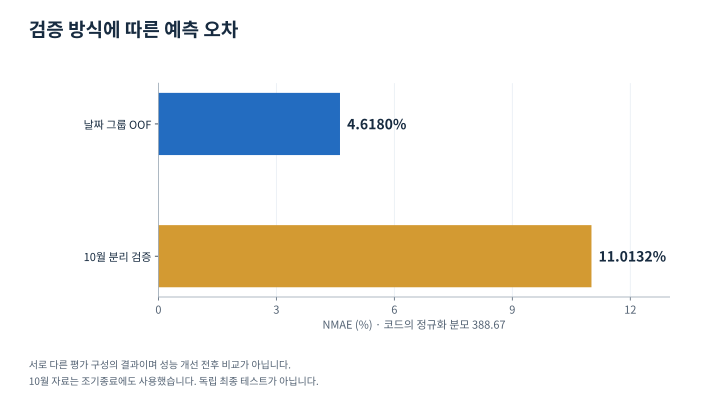
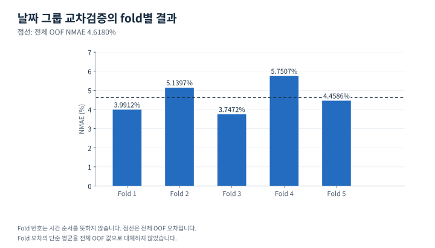

# 풍력 발전 예측과 월 분리 검증

> 게시 검토용 본문 초안. 사이트 반영·배포 전 검토본입니다.

**풍속과 발전기 운전 정보를 결합한 예측 모델을 만들고, 교차검증과 월 분리 검증의 차이를 확인했습니다.**

| 항목 | 내용 |
|---|---|
| 분야 | 에너지 데이터 분석·머신러닝 |
| 담당 | 데이터 점검, EDA, 도메인 피처 설계, 모델 비교, 검증 및 후처리 |
| 도구 | Python, pandas, NumPy, LightGBM, XGBoost, CatBoost, scikit-learn |
| 주요 산출물 | 전처리·EDA 노트북, 앙상블 예측 파이프라인, 평가 결과와 예측 파일 |

<figure class="process-figure">
<figcaption>분석 흐름</figcaption>
<ol><li>01
<strong>기상·운전 데이터</strong>시간·입력·목표 열 점검
</li><li>02
<strong>도메인·시간 피처</strong>공기 밀도·방향·lag·구간 통계
</li><li>03
<strong>모델·후처리</strong>세 모델 결합과 운전 상태 반영
</li><li>04
<strong>검증 범위 비교</strong>날짜 그룹 OOF와 10월 분리 검증
</li></ol>

구현 기록을 요약한 개념도입니다. 피처별 개선율을 측정한 그래프가 아닙니다.

</figure>

## 어떤 문제를 풀었나

풍력 발전량은 같은 풍속에서도 기상 상태와 발전기의 운전 조건에 따라 달라집니다. 바람이 강하더라도 정비나 정지 상태라면 발전량이 줄고, 풍향과 나셀 방향의 차이도 출력에 영향을 줄 수 있습니다. 입력 변수를 그대로 모델에 넣는 데서 나아가, 기상·운전 정보를 발전 원리와 시간 구조에 맞게 표현하고 예측 결과를 검증하는 분석을 진행했습니다.

후속 데이터센터 전력 계획에서 사용할 수 있는 발전량 정보를 만든다는 맥락도 함께 고려했습니다. 다만 이 페이지의 평가 수치는 예측 모델의 로컬 실험 결과이며, 실제 전력 계획의 비용 절감으로 환산하지 않습니다.

## 내가 한 일

원본의 시간 열과 입력·목표 열을 확인하고, 전처리부터 모델 비교와 예측값 후처리까지 구현했습니다. 풍속·기압·기온·풍향·나셀 방향을 탐색하고, 날짜 단위 그룹과 10분 간격에 맞춘 피처를 만들었습니다. 이후 LightGBM·CatBoost·XGBoost를 비교·결합하고, 교차검증과 특정 월을 제외하는 평가의 결과를 함께 남겼습니다.

핵심 작업은 세 부분입니다. 기상 변수를 발전 원리와 연결한 표현으로 바꾸고, 시간 간격에 맞게 과거 구간의 변동을 요약하며, 평가 방식에 따라 성능이 얼마나 달라지는지 확인했습니다.

## 기상과 운전 정보를 어떻게 표현했나

| 피처 묶음 | 구현한 내용 | 분석 의도 |
|---|---|---|
| 공기 밀도·에너지 | 기압·절대온도로 공기 밀도 계산, 밀도×풍속³ | 풍속만으로 설명되지 않는 기상 조건을 표현 |
| 방향 | sin/cos에서 풍향·나셀 방향 복원, 요 오차와 cos² 항 | 바람과 발전기 방향의 관계를 표현 |
| 상대 상태 | 나셀·외부 풍속 비율, 기압·온도 차이 | 센서와 위치에 따른 차이를 표현 |
| 시간 주기 | 하루 시각의 sin/cos | 자정을 포함한 시각의 연속성을 표현 |
| 단기 변화 | 10·20·60분 lag, 차분과 변화율 | 직전 관측과 변동을 반영 |
| 구간 요약 | 1·3·6·12·24시간 풍속의 평균·표준편차·최대·최소 | 순간값과 지속적인 상태를 구분 |

이 피처들이 각각 성능을 얼마나 개선했는지 전부 분리해서 입증한 것은 아닙니다. 피처 설계의 근거와 전체 파이프라인의 평가 결과를 구분해 설명합니다.

## 모델과 후처리의 역할을 나눴다

기록이 남은 비교 파이프라인은 목표값을 `log1p`로 변환해 학습하고, LightGBM 45%·CatBoost 40%·XGBoost 15%의 예측을 로그 공간에서 결합한 뒤 원래 스케일로 복원합니다. 이후 정상 가동 스위치와 정지·정비 관련 열을 이용해 예측을 보정하고 범위를 제한합니다.

모델은 기상과 운전 상태의 비선형 관계를 학습하고, 후처리는 알려진 상태와 값 범위를 반영합니다. 따라서 결과를 해석할 때도 모델 자체의 성능과 후처리를 포함한 성능을 구분해야 합니다. 운전 상태를 이용한 보정은 해당 정보가 실제 예측 시점에 제공되는 사용 상황에서 해석해야 합니다.

## 교차검증과 월 분리 검증을 함께 확인했다

<figure class="evidence-figure">

<figcaption>같은 노트북의 두 평가 결과입니다. 평가 구성과 조기종료 사용 여부를 함께 읽어야 합니다. <a href="assets/wind-validation.svg">원본 확대</a> · <a href="assets/wind-validation.csv">표시 데이터 CSV</a></figcaption>
</figure>

| 평가 방식 | 데이터 분리 | 저장된 NMAE |
|---|---|---:|
| 5-fold 교차검증의 OOF | 날짜를 그룹으로 분리 | 4.6180% |
| 10월 분리 검증 | 10월을 검증에 사용하고 나머지 월로 학습 | 11.0132% |

출처는 동일 노트북의 두 실행 셀과 저장 출력입니다. NMAE는 코드에 설정된 분모 388.67로 MAE를 정규화한 값입니다. 원본 목표 열은 `유효전력생산량(kWh)`인데 실행 로그의 MAE 단위는 kW로 표시돼 있어, 여기서는 원단위 MAE를 대표 성과로 사용하지 않았습니다.

날짜별 교차검증에서 낮은 오차를 얻었더라도 다른 월에서 같은 수준의 성능을 보장하지는 않았습니다. 이를 계절·운전 조건·검증 구성이 달라질 때의 일반화 문제를 검토하는 근거로 삼았습니다. 오차 차이의 원인을 특정 계절 요인 하나로 확정하지는 않았습니다.

10월 자료는 모델의 조기종료에도 사용했습니다. 따라서 위 결과는 월을 분리한 검증이며, 모델 선택에 한 번도 쓰지 않은 독립 최종 테스트가 아닙니다. GroupKFold 역시 날짜를 묶어 나누는 방식으로, 모든 폴드에서 과거로 학습하고 미래를 예측하는 순차 검증과는 다릅니다.

<figure class="evidence-figure">

<figcaption>Fold 번호는 날짜 순서가 아닙니다. 전체 OOF와 각 fold의 결과를 구분했습니다. <a href="assets/wind-folds.svg">원본 확대</a> · <a href="assets/wind-folds.csv">표시 데이터 CSV</a></figcaption>
</figure>

## 핵심 판단과 배운 점

이 활동에서 중요했던 판단은 “가장 낮은 오차를 얻었는가”와 “그 오차가 어떤 상황을 대표하는가”를 함께 보는 것이었습니다. 도메인 피처와 앙상블을 구현한 뒤, 날짜별 분리와 월별 분리의 결과를 나란히 확인해 성능을 설명할 범위를 좁혔습니다.

실제 미래 발전량 예측에 연결하려면 경계 구간의 결측 보완 방식, lag 계산의 정렬·연속성, 현재 운전 상태의 이용 가능 시점을 추가로 확인하고 시간순 검증을 강화해야 합니다. 공식 대회 점수나 운영 시스템 성능은 이 로컬 결과와 분리해 기록합니다.
