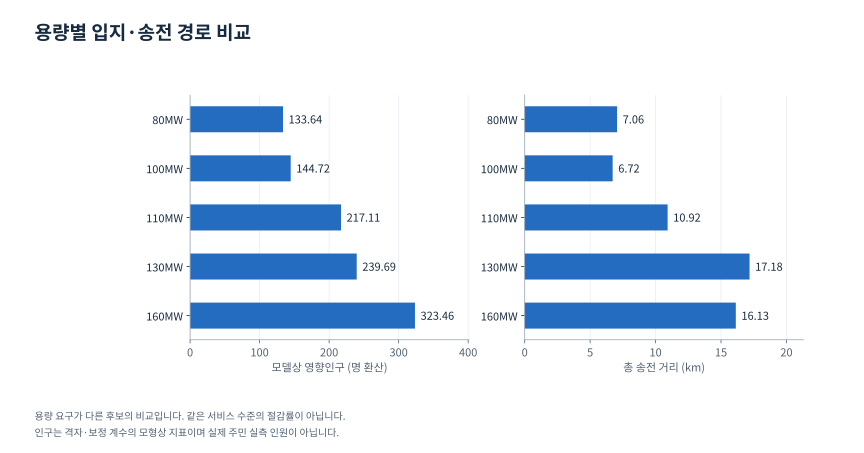
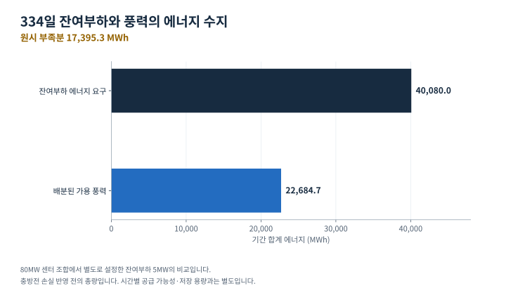

# 데이터센터 입지·송전 경로와 에너지 공급 시나리오

> 게시 검토용 본문 초안. 사이트 반영·배포 전 검토본입니다.

**경주 지역에서 데이터센터 부지와 송전 경로를 함께 탐색하고, 풍력의 변동을 ESS·SMR로 보완하는 시나리오를 분석했습니다.**

| 항목 | 내용 |
|---|---|
| 분야 | 공간 데이터 분석·입지 및 경로 탐색·에너지 시뮬레이션 |
| 담당 | 후보지 생성, 공간·용량 제약, 경로 탐색, ESS 계산, 공급·비용 시나리오 비교 |
| 도구 | Python, pandas, NumPy, 격자 분석, Dijkstra, A*, 시뮬레이션 |
| 주요 산출물 | 후보지·경로 지도, 용량 조합별 비교, 일별·월별 ESS 결과, 장기 공급·비용 표 |

<figure class="process-figure">
<figcaption>연결해서 검토한 의사결정</figcaption>
<ol><li>01
<strong>입지 후보</strong>부지·경사·문화재·면적
</li><li>02
<strong>전력 연결</strong>변전소 용량·거리·격자 경로
</li><li>03
<strong>공급 시나리오</strong>10분 풍력·잔여부하·ESS·SMR
</li><li>04
<strong>운영·비용 조건</strong>일별·연속 SOC와 에너지 수지
</li></ol>

분석 범위를 요약한 개념도입니다. 전체 후보를 동시에 푸는 단일 최적화 모형을 뜻하지 않습니다.

</figure>

## 한 위치를 고르는 데 필요한 조건

데이터센터 입지에는 넓고 평탄한 부지만 있으면 되는 것이 아닙니다. 전력을 공급할 변전소까지 연결할 수 있어야 하고, 그 경로의 길이와 주변 영향, 시설 용량을 함께 고려해야 합니다. 전력 공급에서는 평균 풍력 발전량이 충분해 보여도 부족한 시간대를 버틸 수 있는지가 별도 문제입니다.

이 프로젝트에서는 부지·송전·에너지 공급을 연결했습니다. 먼저 공간과 전력 제약을 만족하는 부지 조합을 만들고, 연결 경로와 영향 지표를 비교했습니다. 그다음 풍력의 10분별 변동을 이용해 부족 전력과 ESS, SMR 공급 시나리오를 검토했습니다.

## 내가 한 일

경주 경계와 격자별 경사·문화재 위험·인구, 변전소 위치와 용량을 이용해 후보지를 생성했습니다. 30MW·50MW 데이터센터의 조합을 만들고 부지 중복, 변전소 이격, 경로 길이와 모델상 영향인구를 검사했습니다.

경로 계산에는 Dijkstra·A*를 적용한 버전이 있고, 후보지 점수만 비교하는 접근에서 부지 경계와 변전소를 실제 격자로 연결하는 방식까지 확장했습니다. 에너지 분석에서는 발전량 단위 변환과 충방전 상태 추적, 필요한 ESS 용량 탐색, 일별·장기 공급과 비용 비교를 구현했습니다.

## 부지와 송전 경로를 함께 비교했다

| 판단 항목 | 분석에 반영한 조건 |
|---|---|
| 부지 | 지역 경계 내부, 문화재 위험 제외, 경사와 필요한 면적 |
| 시설 조합 | 30MW·50MW 조합, 부지 중복 방지 |
| 전력 연결 | 변전소 용량, 이격거리, 경로 연결 가능성 |
| 경로 | 격자상 거리, 송전 경로가 통과하는 인구 지표 |
| 선택 기준 | 공사·송전·주민 영향 등 가중치별 비교 |

직선 거리는 후보지를 빠르게 비교하는 데 유용하지만, 경로가 어떤 격자를 통과하는지 설명하지 못합니다. 부지의 인구만 작게 만드는 것과 송전 경로까지 포함한 영향을 줄이는 것도 다른 문제입니다. 두 범위를 나눠 계산하고 기준을 바꿨을 때 선택이 어떻게 달라지는지 비교했습니다.

다음은 한 노트북의 동일 실행 셀에 저장된 용량별 탐색 결과입니다.

<figure class="evidence-figure">

<figcaption>각 용량 요구에서 선택한 후보를 비교합니다. 실제 주민 실측이나 동일 용량의 절감 효과가 아닙니다. <a href="assets/site-scenarios.svg">원본 확대</a> · <a href="assets/site-scenarios.csv">표시 데이터 CSV</a></figcaption>
</figure>

| 데이터센터 조합 | 총용량 | 모델상 총 영향인구 지표 | 총 송전 거리 |
|---|---:|---:|---:|
| 30MW 1개 + 50MW 1개 | 80MW | 133.64명 환산 | 7.06km |
| 50MW 2개 | 100MW | 144.72명 환산 | 6.72km |
| 30MW 2개 + 50MW 1개 | 110MW | 217.11명 환산 | 10.92km |
| 30MW 1개 + 50MW 2개 | 130MW | 239.69명 환산 | 17.18km |
| 30MW 2개 + 50MW 2개 | 160MW | 323.46명 환산 | 16.13km |

인구는 격자와 보정 계수로 계산한 모형상 지표이며 실제 영향을 받는 주민을 실측한 인원수가 아닙니다. 표는 각기 다른 용량 요구를 충족한 후보 비교로, 동일한 서비스 수준에서의 절감률을 나타내지 않습니다. 후보 생성·제약·목적함수에 따라 선택이 달라져 다른 버전의 최솟값을 한 결과로 합치지 않았습니다.

## 발전량을 ESS의 시간별 잔량으로 연결했다

10분 구간의 발전량을 평균 전력으로 변환한 뒤, 공급과 잔여부하의 차이를 다시 구간 에너지로 바꿔 ESS 잔량을 갱신했습니다. 여유 전력은 용량 한도까지 충전하고 부족분은 방전 효율을 반영해 차감했습니다. 비교 버전에서는 초기 충전 상태와 효율, 풍력 배분과 잔여부하 조건을 바꿨습니다.

필요한 저장 용량은 주어진 발전 프로파일을 끝까지 공급할 수 있는지 확인하면서 탐색했습니다. 평균 필요 용량뿐 아니라 95백분위·최악일, 일별 공급 성공과 장기 연속 운전을 비교했습니다. 95백분위라는 기준을 실제 공급 신뢰도 보증으로 해석하지는 않았습니다.

## 하루 단위 평가와 장기 연속 공급은 달랐다

<figure class="evidence-figure">

<figcaption>80MW 센터 조합의 별도 잔여부하 5MW 조건입니다. 배터리 손실과 시간별 충족 여부를 반영하기 전 총량을 비교했습니다. <a href="assets/energy-balance.svg">원본 확대</a> · <a href="assets/energy-balance.csv">표시 데이터 CSV</a></figcaption>
</figure>

중요한 확인은 ESS 잔량을 날짜마다 초기화하는 실험과 기간 전체에서 이어가는 실험의 차이였습니다. 하루를 버티는 용량이 나와도, 그다음 날의 초기 전력을 어디에서 충전할지는 별도로 설명해야 합니다.

장기 비교 셀의 80MW 센터 조합에는 잔여부하를 5MW로 둔 설정이 있습니다. 이 설정의 334일 자료에서 잔여부하가 요구하는 에너지는 40,080MWh, 배분된 사용 가능 풍력은 약 22,684.7MWh로 기록됐습니다. 약 17,395.3MWh의 차이는 저장 중 손실을 반영하기 전의 원시 에너지 부족분입니다. 5MW는 데이터센터 전체 80MW와 별도로 설정한 보완 대상 부하입니다.

이 조건에서는 ESS 용량만 늘려 부족한 에너지가 생겨나지는 않습니다. 매우 큰 초기 저장 에너지를 허용하면 유한 기간을 버티는 해를 계산할 수 있지만, 반복 운전 가능한 공급 체계와는 다릅니다. 따라서 초기 SOC·외부 충전·전체 에너지 수지를 함께 확인하고, 추가 공급을 포함하는 시나리오로 분석 범위를 넓혔습니다.

## SMR·ESS 비용 비교의 조건

SMR 공급량과 ESS 설치·유지비를 바꾸며 10년 할인 비용을 계산했습니다. 한 계산 버전은 할인율 5%, ESS 설치비 2억원/MWh, 연 유지비 1.5%, SMR PPA 130원/kWh를 가정합니다. 이 값은 모델의 입력 가정이며 현재 시장가격이나 실제 계약 조건으로 제시하지 않습니다.

평균 필요 ESS를 고르는 경우와 95백분위 용량을 고르는 경우에는 비용 순위가 달라졌습니다. 다만 일별로 초기화한 ESS 용량에 기반한 비용표를 그대로 장기 안정 공급의 최저 비용 해로 사용할 수는 없습니다. 공급 조건이 충족되는지와, 그 조건 아래 비용을 비교하는지를 함께 보아야 합니다.

## 이 활동에서 얻은 것

부지·경로·에너지·경제성을 따로 계산해 좋은 숫자만 합치면, 실제로 동시에 성립하지 않는 계획이 될 수 있습니다. 후보 탐색의 공간 범위, 변전소 용량, 전력과 에너지 단위, 배터리의 시작·종료 상태를 연결해 판단하는 것이 이 분석의 핵심이었습니다.

현재 결과는 정해진 후보와 격자·비용·효율 가정에서의 비교입니다. 실제 인허가·계통 접속·주민 수용성이나 사업 경제성을 검증한 성과는 아니며, 후보 축소와 가중치별 선택을 전역 최적성 증명으로 표현하지 않습니다.
