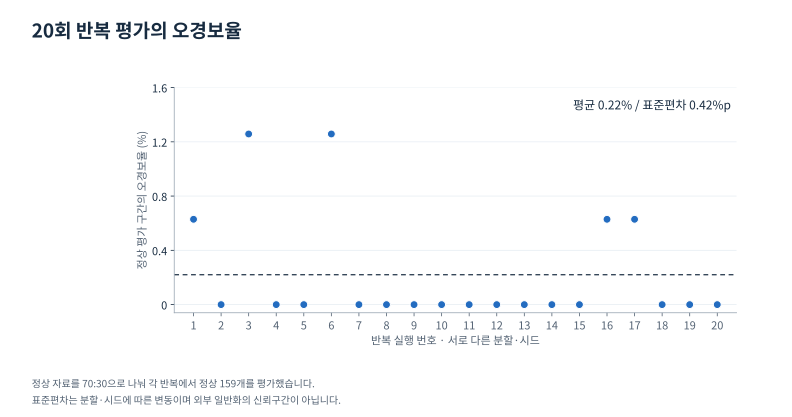
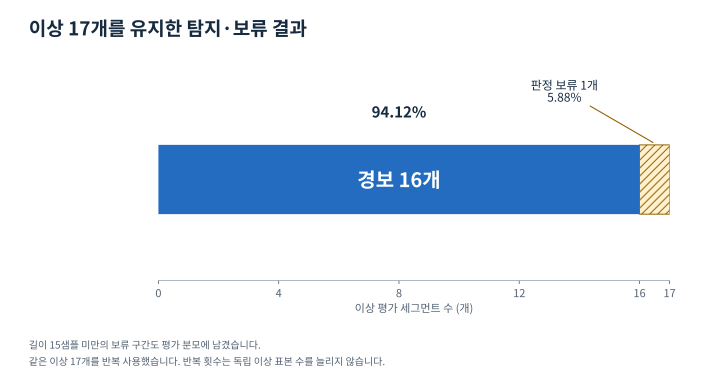

# 프레스 유압펌프 이상탐지와 경보 정책 설계

> 게시 검토용 본문 초안. 사이트 반영·배포 전 검토본입니다.

**정상 데이터 기반 이상탐지에 판정 보류와 위험도 태깅을 결합하고, 오경보 감소와 이상 탐지의 교환관계를 평가했습니다.**

| 항목 | 내용 |
|---|---|
| 분야 | 제조 시계열·이상탐지·모델 검증 |
| 담당 | 문제 정의, 전처리·EDA, 피처 설계, 모델·임계값 비교, 경보 정책, 재현·보고서·발표자료 |
| 도구 | Python, pandas, NumPy, SciPy, scikit-learn, matplotlib |
| 주요 결과 | 최종 개발 평가 오경보율 0.22% ± 0.42%, 이상 16/17개 탐지 |
| 산출물 | 결과보고서 26쪽, 발표자료 15쪽, 01~32번 분석 스크립트와 통합 실행 경로 |

<figure class="process-figure">
<figcaption>판정 보류를 포함한 경보 흐름</figcaption>
<ol><li>01
<strong>세그먼트 구성</strong>정상 530개·이상 17개 분석 대상
</li><li>02
<strong>길이 확인</strong>15샘플 미만은 보류·평가 분모 유지
</li><li>03
<strong>이상 점수</strong>정상 학습·39개 기본 피처·Isolation Forest
</li><li>04
<strong>경보와 위험도</strong>학습 점수 p99로 경보·주기성으로 위험도
</li></ol>

최종 통합 평가 코드의 처리 흐름입니다. 주기성은 이상탐지 모델 입력과 분리했습니다.

</figure>

## 이상을 찾은 뒤 어떤 행동으로 연결할 것인가

프레스 유압펌프의 이상탐지는 이상 샘플을 구분하는 것과 정상 운전에서 불필요한 경보를 줄이는 일을 함께 다뤄야 합니다. 경보가 너무 많으면 담당자가 결과를 신뢰하기 어렵고, 단순히 임계값을 높이면 이상을 놓칠 수 있습니다.

진동 2개 채널과 전류 신호를 이용해 정상만으로 학습하는 이상탐지 모델을 만들었습니다. 이후 모델 점수에 따라 모든 구간을 바로 판정하기보다, 판단할 정보가 부족한 구간을 보류하고 경보 안에서도 위험도를 나누는 정책을 설계했습니다. 저는 데이터 점검부터 모델·정책 비교, 구현 오류 수정, 보고서와 발표자료 정리까지 직접 진행했습니다.

## 데이터의 행보다 운전 구간을 먼저 정의했다

연속으로 수집한 시계열의 각 행을 독립 표본으로 다루면 같은 운전 구간의 정보가 학습과 평가에 반복될 수 있습니다. 시간 gap을 이용해 사이클로 추정되는 세그먼트를 복원하고 구간별 피처를 만들었습니다. 실제 설비의 사이클 메타데이터가 제공된 것은 아니므로 gap 기반 분리라는 전제를 남겼습니다.

10샘플 미만의 짧은 이상 구간 4개를 제외한 분석 대상은 정상 530개·이상 17개 세그먼트입니다. 이 분석 대상 선정과 최종 정책의 “15샘플 미만 판정 보류”는 서로 다른 단계입니다. 최종 정책의 보류 구간은 평가에서 삭제하지 않았습니다.

## 모델 입력과 위험도 판단을 분리했다

| 단계 | 수행 내용 | 선택 이유 |
|---|---|---|
| 구간 표현 | 시간·주파수 영역의 39개 기본 피처 | 점 단위 변화 대신 구간의 진폭·분포·관계를 표현 |
| 모델 비교 | Mahalanobis, Isolation Forest, One-Class SVM, Autoencoder 등 | 정상만으로 학습하는 접근들의 차이를 확인 |
| 임계값 | 정상 학습 점수의 percentile와 분포 기반 방식 비교 | 이상 정답 없이 정할 수 있는 운영 기준 검토 |
| 판정 보류 | 길이 15샘플 미만 구간은 경보 판정 보류 | 짧은 구간의 불안정성을 정책으로 처리 |
| 위험도 태깅 | 경보 구간의 주기성 비율 이용 | 이상 점수와 점검 우선순위의 역할을 구분 |

최종 Isolation Forest는 정상 학습 자료로 표준화하고 39개 기본 피처로 학습했습니다. 정상 학습 점수의 p99를 임계값으로 고정하고, 구간 길이에 따라 경보를 보류하더라도 임계값을 다시 맞추지 않았습니다. 주기성은 모델 입력과 분리해 경보 후 위험도 판단에 사용했습니다.

검토 중 주기성 피처가 모델 입력에 섞이던 구현 오류를 발견했습니다. 설명한 파이프라인과 실제 코드가 일치하도록 수정하고 결과를 다시 산출했습니다. 이전 0.13%는 폐기하고 수정 후 0.22%를 사용했습니다.

## 오경보 감소와 판정 보류를 함께 보고했다

<figure class="evidence-figure">

<figcaption>최종 결과 CSV의 20개 시드 값을 그대로 표시했습니다. 변동은 독립 현장 성능의 신뢰구간이 아닙니다. <a href="assets/kamp-repeats.svg">원본 확대</a> · <a href="assets/kamp-repeats.csv">표시 데이터 CSV</a></figcaption>
</figure>

최종 파이프라인은 정상 자료를 70% 학습·30% 평가로 나누는 과정을 20개 시드에서 반복했습니다. 각 반복의 정상 평가 표본은 159개이며, 이상 17개는 동일한 개발 표본을 사용했습니다.

| 최종 통합 평가 항목 | 결과 | 해석 |
|---|---:|---|
| 정상 평가 구간의 오경보율 | 평균 0.22%, 표준편차 0.42%p | 정상 분할·시드에 따른 반복 결과 |
| 이상 탐지율 | 94.12% (16/17) | 경보를 낸 이상 구간 |
| 이상 판정 보류율 | 5.88% (1/17) | 짧은 구간으로 판정을 보류한 이상 |

p95 임계값 비교 기록의 정상 오경보율은 약 5.41%, p99는 약 1.07%이며, 최종 길이 정책을 포함한 결과는 약 0.22%입니다. **이 변화에는 임계값과 경보 정책의 차이가 함께 포함됩니다.** 모델 하나의 교체나 특정 피처 하나의 효과로 설명하지 않습니다. 임계값 비교와 최종 통합 평가는 반복 구성도 달라 전체 비교 조건을 함께 확인해야 합니다.

<figure class="evidence-figure">

<figcaption>동일한 이상 17개를 반복 평가했습니다. 자동 경보를 내지 않은 구간을 함께 보여줍니다. <a href="assets/kamp-detection.svg">원본 확대</a> · <a href="assets/kamp-detection.csv">표시 데이터 CSV</a></figcaption>
</figure>

이상 1개를 보류했다고 평가에서 제외하면 탐지율을 과대평가할 수 있습니다. 저는 보류한 구간도 17개라는 분모에 남겨, 경보를 줄인 대신 자동 판정하지 못한 범위를 함께 제시했습니다.

## 임계값은 최소 오경보 하나로 고르지 않았다

임계값 비교에서 오경보가 가장 낮았던 방식은 p99가 아니라 median+5MAD였습니다. p99를 선택한 이유를 최저 오경보라고 설명하던 문구를 정정하고, 정상 점수의 상위 백분위라는 운영 단순성과 설명 가능성을 선택 근거로 기록했습니다.

이는 p99가 외부 설비에서도 최선이라는 뜻은 아닙니다. 어떤 구간에 자동 경보를 내고 무엇을 담당자 확인으로 넘길지, 그리고 그 기준을 유지·설명할 수 있는지를 함께 검토한 결정입니다.

## 수집일 차이와 짧은 신호의 한계도 점검했다

정상과 이상은 서로 다른 날짜에 수집됐습니다. 모델이 고장 특성 대신 날짜별 환경을 구분했을 가능성을 검토하기 위해 정상 세션 내부의 시간 표류와 이상 방향을 비교했습니다. 그러나 각 상태의 세션이 하나씩뿐이어서 날짜에 따른 불연속적 변화까지 배제하지는 못했습니다.

스펙트럼 분석에서도 짧은 구간의 주파수 특성을 과신하지 않도록 길이와 추정법의 민감도를 확인했습니다. 이미 시작된 이상을 감지하는 능력과 고장 발생 전의 선행 예측, 위험 점수와 절대 고장확률을 구분해 보고서의 주장 범위를 정리했습니다.

## 재현과 현장 적용 사이의 다음 단계

분석 스크립트와 결과를 통합 실행 경로로 정리하고, 상대경로·의존성과 보고서·발표자료의 수치를 맞췄습니다. 성능 수치뿐 아니라 분모·보류·임계값·피처의 역할이 구현과 일치하는지 확인한 것이 중요한 산출물입니다.

현재 결과는 소수 이상 표본을 반복 사용한 개발 평가입니다. 다음 단계에서는 다른 날짜·설비·부하 조건의 독립 세션과 실제 운전 로그를 확보해, 오경보·미탐·판정 보류가 현장 대응에 미치는 영향을 검증해야 합니다.
