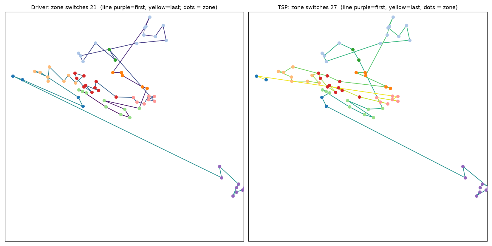
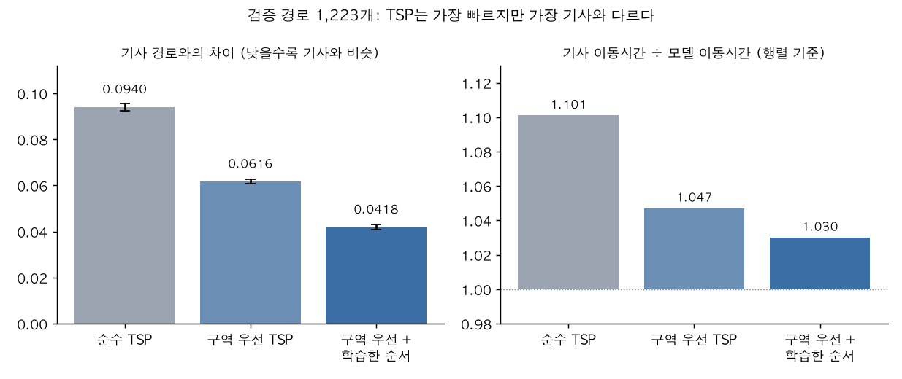
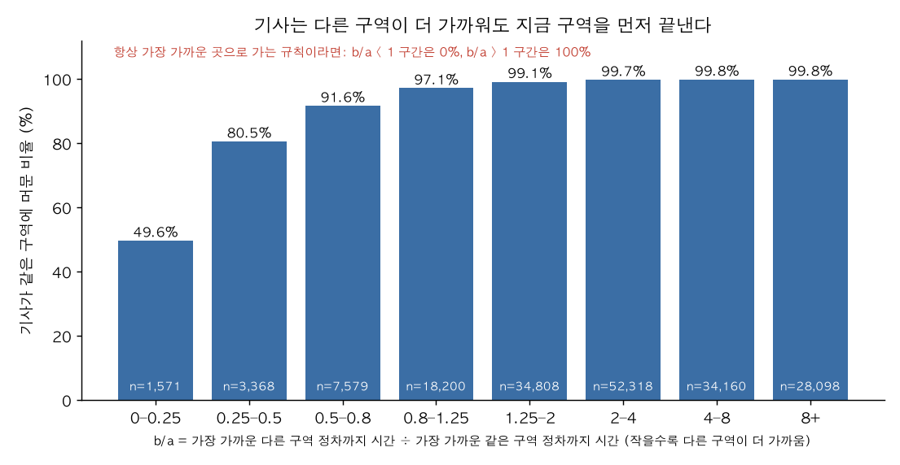

Amazon이나 Uber 같은 회사는 배송 경로를 어떻게 짤까요. 이 궁금증에서 시작해서, Amazon이 공개한 실제 배달 기사 경로 6,112개에 교과서의 경로 최적화 이론(VRP)을 그대로 적용해 봤습니다. 결과는 의외였습니다. 기사들은 이론이 말하는 최단 순서보다 약 10% 오래 걸리는 길로 다니고 있었고, 그 차이의 가장 큰 이유는 **구역 단위로 일하는 방식**이었습니다. 이 글은 거기까지 가는 동안 무엇을 시도했고, 어디서 막혔고, 무엇이 틀렸고, 무엇을 배웠는지의 기록입니다. 끝내 증명하지 못한 것도 함께 적었습니다.

## 왜 시작했나

처음 질문은 단순했습니다. 실제 회사들은 VRP를 어떻게 풀까. 공개된 자료는 많지 않았는데, Amazon이 2021년에 실제 배달 기사들이 다닌 경로를 그대로 공개한 챌린지를 열었다는 걸 알게 됐습니다. 기사가 정차 지점을 어떤 순서로 돌았는지가 들어 있는 드문 데이터였습니다.

그래서 질문이 구체적으로 바뀌었습니다. 교과서대로 최단 경로를 구하면 정말 기사들이 간 경로보다 나을까. 아니라면 왜 아닐까. 처음 목표는 기사의 습관을 흉내 내는 모델을 만들고 거기서 더 발전시키는 것이었습니다. 이 목표는 오래 가지 못했습니다. 아래 "막힌 곳 1"에서 이야기합니다.

## 먼저 이론부터: VRP와 TSP

창고(depot) 하나에서 출발하는 차량 $K$대가 고객 $N=\{1,\dots,n\}$을 모두 방문하고 돌아옵니다. 고객 $i$의 수요는 $q_i$, 차량 용량은 $Q$, 두 지점 $i,j$ 사이의 비용(거리 또는 시간)은 $c_{ij}$입니다. 결정할 것은 **어느 차량이 어느 고객을 맡는지**(배정)와 **그 안에서 어떤 순서로 가는지**(순서) 두 가지이고, 목표는 총비용 최소화입니다.

$N_0=N\cup\{0\}$(0은 depot)라 하고, $x_{ij}=1$이면 호 $(i,j)$를 지나갑니다. $u_i$는 고객 $i$까지 서비스한 뒤 차에 실린 누적 수요입니다.

$$
\begin{aligned}
\min\ & \sum_{i\in N_0}\sum_{j\in N_0,\,j\ne i} c_{ij}\,x_{ij}\\
\text{s.t.}\ & \sum_{j\ne i} x_{ij}=1,\quad \sum_{j\ne i} x_{ji}=1 && \forall i\in N\\
& \sum_{j\in N} x_{0j}=\sum_{j\in N} x_{j0}=K\\
& u_j \ge u_i + q_j - Q\,(1-x_{ij}) && \forall i,j\in N,\ i\ne j\\
& q_i \le u_i \le Q,\qquad x_{ij}\in\{0,1\}
\end{aligned}
$$

첫 제약은 모든 고객을 정확히 한 번 방문한다는 뜻이고, 둘째 줄은 차량 $K$대가 depot에서 나가고 돌아온다는 뜻입니다. 셋째 제약은 용량을 지키면서 depot에 연결되지 않는 부분순환을 없앱니다. 고객마다 허용 시간대 $[a_i,b_i]$가 있으면(VRPTW) 방문 시각 $t_i$에 대해 $t_j \ge t_i + s_i + \tau_{ij} - M(1-x_{ij})$, $a_i\le t_i\le b_i$를 더합니다. 차량이 1대이고 용량 제약이 없으면($K=1$) TSP가 됩니다. 배정이 이미 정해져 있다면 차량마다 TSP 하나씩 푸는 문제로 줄어듭니다.

VRP는 NP-hard라서 규모가 커지면 정확해법 대신, 해를 만든 뒤 국소 탐색으로 개선하는 휴리스틱을 씁니다. 저도 OR-Tools의 Guided Local Search로 풀었습니다.

수식을 쓰면서 이론이 깔고 있는 가정이 눈에 들어왔습니다. 이 가정들을 하나씩 의심해 보는 것이 이 글의 뼈대가 됐습니다.

1. 배정과 순서를 한 번에 최적화합니다. 지역을 먼저 나눠 맡기는 단계가 따로 없습니다.
2. 비용 $c_{ij}$가 정확하고, 목표는 총 이동시간 하나입니다.
3. 모든 고객은 서로 대등하고, 순서는 비용만으로 정해집니다.
4. 비용은 이동뿐입니다. 서비스 시간은 상수이거나 무시됩니다.
5. 제약은 용량, 시간창처럼 수식에 쓴 것뿐입니다.
6. 비용은 시간에 따라 변하지 않습니다.

## 데이터를 구하고 TSP로 풀어 봤습니다

데이터는 챌린지의 학습용 경로 6,112개입니다. 2018년 미국 5개 대도시권의 정거장 17곳, 39일치이고, 경로당 배달 정차는 평균 147개, 구역은 평균 20개입니다. 정차 지점의 위경도와 구역 ID, 정차 사이 이동시간, 기사가 실제로 방문한 순서, 소포 크기, 계획 서비스 시간, 시간창, 출발 시각, 경로 품질 라벨이 들어 있습니다. 데이터 논문을 읽고서야 알게 된 필드의 뜻은 이렇습니다.

- 이동시간은 모델이 추정한 값이 아니라 과거에 실제로 걸린 시간의 평균입니다.
- 구역은 Amazon이 내부적으로 만든 지리적 계획 구역입니다.
- 품질 라벨은 배달 결함, 기사 경험, 고객 만족, 생산성 같은 차원을 분석해 붙였습니다.
- 계획 서비스 시간은 예상값이지 실측이 아닙니다.
- 위경도는 익명화를 위해 교란되어 있습니다.

없는 것도 중요했습니다. 정차별 실제 도착 시각, GPS 궤적, 기사 ID, 그리고 Amazon이 기사에게 제시했을 계획 경로는 없습니다. 정차를 어느 기사가 맡을지는 이미 정해져 있어서, 저는 경로마다 차량 한 대의 TSP를 풀었습니다. VRP 중 "순서" 부분만 본 셈입니다.

TSP는 OR-Tools로 경로당 1초 제한을 두고 풀었습니다. 나중에 20초까지 돌려 보니 평균 1.35% 더 짧은 해가 나와서, 제 TSP는 최적해가 아니라 시간 제한 휴리스틱 해라는 걸 알게 됐습니다. 기사와 비슷한 정도는 Amazon 공식 채점 지표로 쟀습니다. 낮을수록 기사 경로와 비슷하다는 뜻입니다. 공식 구현이 느려서 같은 계산을 빠르게 다시 만들고, 공식 결과와 일치하는지 대조했습니다.

### 첫 결과는 의외였습니다

무작위로 고른 학습 경로 200개에서 기사 경로와 TSP 경로를 비교했습니다.

| | 기사 | TSP |
|---|---|---|
| 총 이동시간(이동시간 행렬 기준) | 12,811초 | 11,765초 |
| 구역을 옮기는 횟수 | 20.6회 | 36.0회 |
| 다음 정차가 가장 가까운 남은 곳 | 66% | 75% |

기사 경로가 TSP보다 8.9% 길었습니다. 검증용 경로 1,223개에서 경로마다 비율을 내 평균하면 1.101입니다. 그런데 더 흥미로웠던 건 시간 차이보다 **움직임의 모양**이었습니다. "가까운 곳부터 간다"는 기사의 특징이 아니었습니다. TSP가 오히려 더 자주 그렇게 했습니다. 달랐던 건 구역을 옮기는 횟수였습니다. 기사는 TSP보다 구역을 40% 적게 옮겼습니다.

## 막힌 곳 1: 점수를 낮추는 게임

처음 목표가 기사를 흉내 내는 거였으니 점수부터 낮추려 했습니다. 구역을 옮길 때 큰 벌점을 주면 TSP 점수가 0.0940에서 0.0616으로 내려갔습니다. 학습 경로에서 구역 사이 이동 빈도를 세어 그걸 비용으로 더하면 0.0418까지 내려갔습니다.

| | 기사 경로와의 차이 | 기사 시간 ÷ 모델 시간 |
|---|---|---|
| 순수 TSP | 0.0940 | 1.101 |
| 구역 벌점을 준 TSP | 0.0616 | 1.047 |
| 구역 벌점 + 학습한 구역 순서 | 0.0418 | 1.030 |

검증 경로 1,223개 전체에서 잰 값이고, 순수 TSP에서 마지막 방식까지 점수 차이는 표준오차의 수십 배입니다. 여기까지는 잘 풀렸습니다. 그다음부터 막혔습니다.

- 구역 쌍마다 비용을 퍼셉트론으로 학습했더니 검증에서 나아지지 않았습니다. 보정을 키울수록 오히려 나빠졌습니다.
- 확률 계산의 평활화 값을 바꿔 봤지만 원래 설정이 가장 좋았습니다.
- 처음 보는 구역 쌍을 지리 정보로 메워 봤더니 기사와 더 달라졌습니다.
- 출발 시각과 요일을 넣어 봤지만 예측이 나아지지 않았습니다.

그러다 질문 하나가 모든 걸 멈추게 했습니다. **정답이 없는 문제인데, 저는 무엇을 보고 나쁘다고 판단하고 있었을까요.** 제가 낮추려던 점수는 기사 경로와 얼마나 비슷한가일 뿐 효율이 아니었습니다. 기사와 똑같이 가는 게 좋은 경로라는 보장이 어디에도 없었습니다. 이 데이터로 정직하게 주장할 수 있는 건 "기사의 선택을 이 정도로 예측했다"까지였습니다.

여기서 질문을 바꿨습니다. 기사를 더 잘 흉내 내는 법이 아니라 **기사는 왜 최단 경로로 가지 않는가**를 알고 싶다고 했습니다.

## 질문을 바꾸니 할 일이 분명해졌습니다

앞에서 적어 둔 이론의 가정을 현실과 하나씩 맞대어 보기로 했습니다. 다섯 측면으로 묶었고, 요인마다 TSP와 무작위 순서를 대조군으로 두었습니다. 대조군이 없으면 숫자가 나와도 그게 기사 때문인지 지리 때문인지 알 수 없기 때문입니다.

### 작업 구조: 배정도 순서도 구역 단위입니다

가장 먼저 풀린 건 짧은 한마디였습니다. 기사는 여러 명이니까 지역을 나눠서 한 명씩 맡기는 건 당연하다는 것입니다. 그러고 보니 이론은 배정과 순서를 한 번에 푸는데, 현실은 먼저 구역으로 나눕니다. 이게 맞는지 데이터로 확인했습니다.

같은 정거장, 같은 날의 경로들(평균 12.4개)이 구역을 나눠 갖는지 봤습니다. 전체 구역 ID 기준으로, 같은 날 다른 경로에도 나타나는 구역은 0.0%였습니다. 그날의 정차를 경로 크기만 유지한 채 무작위로 다시 나눠 주면 99.3%가 겹칩니다. 구역 하나를 한 경로가 독점하는 정도는 실제 100%, 무작위 27.5%였습니다. 상위 구역(구역 ID의 앞부분)은 가끔 기사들이 나눠 갖지만 세부 구역은 한 기사에게 통째로 배정되고 있었습니다. 이 데이터는 그날의 모든 경로가 아니라 일부라서 겹침이 더 적게 잡히겠지만, 무작위와의 차이는 압도적입니다.

배정이 구역 단위라는 것과 배정된 구역을 **하나씩 끝내며** 도는 건 별개의 일입니다. 한 기사에게 구역이 여럿 배정된 뒤에도 구역을 섞어 돌 수 있고, TSP가 실제로 그렇게 합니다. 기사 경로가 그렇지 않은지 걸음마다 따져 봤습니다. 현재 구역에서 가장 가까운 남은 정차와 다른 구역에서 가장 가까운 남은 정차를 비교하고, 기사가 어느 쪽으로 가는지 센 것입니다(무작위 경로 1,500개에서 180,102걸음).

두 구역까지의 거리가 거의 같을 때 기사의 97.1%가 같은 구역에 머물렀습니다. 다른 구역의 정차가 2배에서 4배 더 가까워도 80.5%가 머물렀고, 4배 이상 가까운 구간에서도 약 절반이 머물렀습니다. 같은 구역 정차가 단순히 더 많아서 생긴 착시일 수도 있어서, 가까운 후보 중에서 아무거나 고른다고 가정한 기대값과도 비교했습니다. 기대는 46.5%인데 실제는 97.2%였습니다.

이걸 현실의 배달로 읽으면 주차와 도로가 떠오릅니다. 배달 차량은 아무 데나 설 수 없습니다. 주차할 수 있는 곳에 세우고 걸어서 근처 정차를 처리합니다. 같은 구역을 한 번에 끝내면 차를 세우고 다시 출발하는 횟수가 줄 수 있고, 구역을 오가면 그때마다 주차 자리를 다시 찾고 도로를 돌아가야 할 수 있습니다. 일방통행, 회전 제한, 진입하기 어려운 길이 있으면 직선으로 가까운 정차가 실제로는 멀 수도 있습니다. Amazon의 소개 글도 기사가 어려운 길과 주차할 곳을 안다고 씁니다. 다만 이건 가설입니다. 데이터에는 주차 위치도 도로망도 없고, 이동시간 행렬이 주차와 도보를 얼마나 반영했는지도 알 수 없습니다.

이 습관의 비용도 쟀습니다. 구역 벌점을 준 TSP는 순수 TSP보다 약 5% 길어지고, 이는 기사와 TSP의 시간 격차(약 10%)의 절반쯤을 메웁니다. 학습한 구역 순서까지 넣으면 격차의 약 68%가 줄었습니다. 평균 비율로 환산한 근사이고, 격차의 원인을 쪼갠 건 아닙니다.

기대했던 연결은 나오지 않았습니다. 구역을 더 엄격히 지키는 경로가 Amazon의 품질 라벨이 높은 경로일 거라 생각했는데, 다른 구역이 더 가까운 걸음에서 현재 구역에 머문 비율이 High 88.2%, Medium 87.6%, Low 88.3%로 같았습니다. 구역 우선은 좋은 경로의 특징이 아니라 모든 경로에 공통된 방식이었습니다. 대신 정거장별 차이가 컸습니다. 같은 지표가 어느 정거장에서는 77.6%, 어느 정거장에서는 94.8%였습니다.

### 비용 추정: 이동시간 행렬

VRP는 비용이 정확하다고 가정합니다. 이 데이터의 이동시간은 과거에 실제로 걸린 시간의 평균입니다. 평균 교통 상황은 담지만 특정 날짜나 시간대, 기사별 차이는 묻힙니다. 구역 경계가 이동시간과 무관하지는 않았습니다. 직선거리가 같을 때 다른 구역의 정차 쌍은 같은 구역 쌍보다 이동시간이 평균 1.4배에서 2.3배 길었습니다. 구역이 도로 구조와 어느 정도 겹친다는 정황입니다. 그러나 이게 기사가 구역을 지키는 이유인지는 실제 도착 시각이 없어서 검증하지 못했습니다.

### 작업량: 소포와 서비스 시간

큰 소포나 많은 소포를 먼저 내리는지 봤습니다. 소포의 부피, 가장 큰 소포, 소포 수는 방문 순서와 상관이 0이었습니다(6,112개 경로, 약 0.001). 반면 계획 서비스 시간은 달랐습니다. 전체 상관으로는 작았지만(마이너스 0.044), 경로의 앞 15%와 뒤 15%를 비교하니 기사 경로의 65.1%에서 앞쪽의 평균 서비스 시간이 뒤쪽보다 길었습니다. 무작위 순서에서는 50.0%입니다. 서비스 시간이 오래 걸리는 정차를 앞쪽에서 처리하는 경향입니다. 왜 그런지는 식별하지 못했습니다.

### 시간: 시간창과 출발 시각

시간창은 정차의 6.4%에만 있고 대부분 7시간에서 9시간짜리라 엄격한 제약은 아닙니다. 그래도 일찍 닫히는 창을 약간 일찍 방문하는 경향이 있었습니다. 순서와의 상관이 3,124개 경로에서 +0.155(무작위 +0.001)였고, 대조군 비교에서 기사 +0.151, TSP와 구역 TSP는 마이너스 0.03 안팎이었습니다. 지리 때문이 아니라 기사에게만 나타나는 작은 신호입니다. 출발 시각과 요일은 구역 순서 예측을 나아지게 하지 못했습니다. 다만 출발 시각은 구역을 방문하는 시각의 약한 대용이라 시간대 효과 자체를 없다고 하긴 어렵습니다.

### 습관: 방향

기사는 depot에서 멀어지며 도는 경로가 38%, 가까워지며 도는 경로가 31%, 중간이 30%였습니다. 정거장, 거리 분포, 요일, 출발 시각, 품질 라벨로 예측해 봤지만 맞히지 못했습니다(AUC 0.49에서 0.53). TSP의 방향과도 일치하지 않았습니다.

### 한눈에 보면

| 측면 | 본 것 | 결과 | 확신 |
|---|---|---|---|
| 작업 구조 | 구역 단위 배정 | 같은 날 경로는 구역을 공유하지 않음(0.0% 대 무작위 99.3%) | 높음 |
| 작업 구조 | 구역 단위 순서 | 뚜렷함. 후보 수 때문이 아님 | 높음 |
| 작업 구조 | 구역 순서의 원인 | 기사의 선호인지 Amazon의 계획인지 구별 못 함 | 낮음 |
| 비용 | 이동시간 행렬 | 구역 경계와 겹치는 정황. 원인인지는 검증 못 함 | 낮음 |
| 작업량 | 소포 크기·수 | 영향 없음 | 높음 |
| 작업량 | 계획 서비스 시간 | 앞쪽에 몰림(65% 대 50%) | 중간 |
| 시간 | 시간창 | 작은 신호(+0.15), 기사에게만 | 중간 |
| 시간 | 출발 시각·요일 | 예측 개선 없음 | 낮음 |
| 습관 | 방향 | 예측 못 함 | 낮음 |

## 막힌 곳 2: 데이터에 없는 것

가장 하고 싶었던 질문은 끝내 풀지 못했습니다. 구역을 끝까지 하는 게 실제로 시간을 아끼는가, 아니면 손해인가. 이 데이터에는 정차별 실제 도착 시각이 없고, 이동시간 행렬은 평균이라 TSP가 이긴다는 말도 행렬 기준일 뿐입니다. 설령 도착 시각이 있어도 문제가 남습니다. 실제 시각은 기사가 간 경로에서만 관측되고, TSP나 구역 우선 경로는 실행된 적이 없습니다. 그 시간은 따로 추정하거나 실험해야 합니다.

기사가 정말 혼잡을 피하는지, 어느 시간에 어느 길을 기피하는지는 더 막막했습니다. 그건 따로 있는 데이터가 아니라 GPS 궤적에서 뽑아야 하는 결과입니다. 이 문제를 제대로 알려면 필요한 것은 다음과 같습니다.

- **Amazon이 기사에게 제시한 계획 경로.** 구역 순서가 기사의 선택인지 계획인지 가르는 가장 직접적인 데이터입니다. 공개되지 않았습니다.
- **정차별 실제 도착과 출발 시각, GPS 궤적.** 실제 효율과 정체, 주차 위치와 체류 시간을 볼 수 있습니다.
- **실제 도로망.** 구역 경계가 도로 장벽과 겹치는지 볼 수 있습니다. 무료인 OpenStreetMap이 있지만 좌표가 교란되어 있어 정차와의 정확한 대응은 한계가 있습니다.
- **구역의 정의, 기사 ID, 소포 적재 순서.** 구역이 어떻게 나뉘는지, 습관이 개인별인지, 구역 단위 작업이 적재 방식에서 오는지를 가르는 데이터입니다.

## 저보다 먼저 같은 길을 간 사람들

선행 연구는 중간에야 읽었습니다. 읽고 나서 놀랐습니다. 같은 데이터로 같은 길을 이미 간 사람들이 있었습니다.

- **우승팀(Cook, Held, Helsgaun, 점수 0.0248).** 머신러닝이 아니라 조합 최적화였습니다. 학습 경로에서 고품질 경로가 만족하는 제약을 찾아 TSP 계열 국소 탐색에 넣었습니다. 가장 먼저 쓴 단서가 구역 ID였습니다. 기사 경로는 같은 구역 정차를 연속으로 방문하니 구역을 묶어 푸는 TSP로 만들었고, 그다음 학습 경로에서 구역 순서를 가져왔습니다.
- **2위 팀(Guo, Mo, Wang, 0.0353).** 구역 순서를 TSP로, 구역 안을 TSP로 푸는 두 단계 모델입니다. 구역 순서만 맞으면 구역 안을 섞어도 점수가 약 0.02까지 내려간다고 보고했습니다. 순수 머신러닝은 학습 경로가 6천 개 수준이라 TSP 기반 방법을 넘지 못했다고 합니다.
- **AWS 연구진(Wu 등, 0.0374).** 구역 순서를 순차 확률 모델로 학습하고 구역 안은 TSP로 풀었습니다. 구역 순서를 정답으로 주면 점수가 0.0116이고 알파벳순이면 0.08입니다. 남은 오차의 거의 전부가 구역 순서에서 나온다는 뜻입니다.
- **Canoy와 Guns(2019).** 챌린지 이전에 이미 거리 행렬 대신 과거 경로에서 학습한 전이 확률을 비용으로 쓰는 방식을 제안했습니다. 제가 구역 이동 빈도를 비용으로 쓴 것과 같은 구조입니다.

제가 발견했다고 생각한 것 중 많은 부분이 이미 알려져 있었습니다. 구역을 먼저 끝낸다는 패턴, 구역 순서가 점수를 지배한다는 것, 소포 크기와 순서가 무관하다는 것, 서비스 시간이 긴 정차를 앞에서 처리한다는 것이 그렇습니다. 반대로 제가 읽은 범위에서 찾지 못한 것은 이런 것들입니다. 같은 날 경로들이 구역을 나눠 갖는다는 것을 무작위 재배분과 견준 확인, 구역 선호의 크기를 걸음마다 잰 것, 그 습관의 이동시간 비용, 구역 선호가 품질 라벨과는 무관하다는 것, 요인마다 대조군을 두고 안 나온 것까지 기록한 것. 다만 읽은 범위의 이야기일 뿐 "아무도 안 했다"는 뜻은 아닙니다. 점수로는 선행 연구에 미치지 못합니다. 검증 경로 구성이 달라 직접 비교도 되지 않습니다.

한 가지 해석은 달랐습니다. 2위 팀은 구역 ID가 경로 계획을 단순화하려는 용도이고 기사는 Amazon이 짠 계획을 대체로 따른다고 봅니다. 그렇다면 기사들이 구역을 먼저 끝내는 건 기사의 습관이 아니라 Amazon의 계획 방식 때문입니다. 반대로 Amazon은 기사가 현장 지식(어려운 길, 정체, 주차) 때문에 계획을 벗어난다고 설명합니다. 제 결과는 두 설명 어느 쪽과도 맞고, 가를 수 없었습니다.

## 제가 틀렸던 것들

분석하는 동안 숫자가 틀리거나 말이 틀린 일이 여러 번 있었습니다. 대부분 대조군이나 외부의 비판적 검토 덕분에 잡았습니다.

- **소포 분석에서 depot을 순서 맨 앞에 넣었습니다.** 무작위 순서에서도 가짜 상관이 +0.0256이나 나왔고, 이상해서 무작위 순서를 기준으로 삼아 확인하다 알았습니다.
- **시간대 분석의 비교가 불공평했습니다.** 출발 시각을 넣은 모델이 크게 나아진 것처럼 보였는데, 라벨을 무작위로 섞은 대조군도 똑같이 나아졌습니다. 확률 추정 방식이 달라서 생긴 착시였습니다.
- **시간창 상관을 과소 추정했습니다.** 같은 종료 시각의 순위를 임의로 갈라서 0.09로 나왔고, 다른 AI에게 글을 비판적으로 검토시킨 뒤 동점을 평균 순위로 다시 계산해서야 +0.155가 나왔습니다.
- **TSP를 "최적"이라고 불렀습니다.** 1초 휴리스틱 해였고 20초를 주면 더 짧아졌습니다.
- **이동시간 행렬을 모델 추정치라고 불렀습니다.** 데이터 논문을 읽으니 과거 실제 이동시간의 평균이었습니다.
- **우승 방식을 머신러닝이라고 기억하고 있었습니다.** 논문을 읽어 보니 조합 최적화였습니다.

설정을 고르는 과정에서도 허점이 있었습니다. 초기 설정 탐색에 검증 경로 일부를 썼기 때문에 최종 점수가 설정 선택과 완전히 분리되어 있지 않습니다. 한계에 적어 둡니다.

## 배운 것

- **정답이 없는 문제에서는 점수보다 먼저 무엇을 주장할 수 있는지를 정해야 합니다.** 점수를 낮추는 데 한참을 쓴 뒤에야 그 점수가 효율이 아니라는 걸 알았습니다.
- **대조군이 숫자를 믿게 만듭니다.** 무작위 순서, TSP, 라벨 섞기. 이게 없었다면 위의 틀린 결과 중 여럿이 그대로 글에 들어갔을 것입니다.
- **이론의 가정을 목록으로 적고 하나씩 깨 보면 막연한 질문이 구체적인 시험이 됩니다.** 가장 큰 간극이 비용이 아니라 배정과 순서를 한 번에 푼다는 첫 번째 가정에서 나왔습니다.
- **실무는 문제를 쪼개서 풉니다.** 구역으로 나눠 배정하고, 각자 구역 순서와 구역 안 순서를 정합니다. 이론은 한꺼번에 풉니다. 이 차이가 이 프로젝트의 가장 큰 결론입니다.
- **선행 연구는 처음에 읽는 게 맞습니다.** 중간에 읽어서 겹침을 늦게 알았습니다. 그래도 읽고 나서야 제 결과를 어디에 놓아야 하는지 보였습니다.
- **안 된 것도 기록합니다.** 퍼셉트론, 평활화, 시간대, 방향. 안 되는 이유를 아는 것도 결과입니다.
- **AI 도구와 일할 때는 그럴듯한 숫자를 그대로 믿지 않습니다.** 이 분석의 코드와 문헌 조사는 AI 도구(Claude Code, 일부 검토에는 Codex)와 함께 했습니다. 숫자가 그럴듯해 보일수록 대조군과 별도의 검토로 확인해야 했습니다.

## 이론과 실제의 간극, 그리고 더 해 보고 싶은 것

| VRP 이론의 가정 | 이 데이터에서 본 현실 |
|---|---|
| 배정과 순서를 한 번에 최적화한다 | 구역 단위로 먼저 배정하고 각 기사가 구역 순서와 구역 안 순서를 정한다 |
| 비용이 정확하다 | 이동시간은 과거 평균이다. 구역 경계에서는 이동시간이 길지만, 기사는 거의 같은 거리의 다른 구역 대신 현재 구역을 97% 택한다 |
| 고객은 대등하고 비용이 순서를 정한다 | 구역을 먼저 끝낸다. 다른 구역이 4배 가까운 구간에서도 약 절반이 머문다 |
| 비용은 이동뿐이다 | 주차, 도보, 서비스 시간이 있다. 서비스 시간이 긴 정차를 앞에서 처리한다 |
| 시간창은 하드 제약이다 | 폭이 넓은 시간창이 부드러운 경향으로 나타난다 |
| 비용은 시간에 따라 변하지 않는다 | 혼잡과 시간대는 데이터가 없어 직접 시험하지 못했다 |
| 관측된 경로는 기사의 독립적 선택이다 | 기사는 Amazon의 계획 경로를 조정할 수 있고, 구역은 Amazon의 계획 구역이다 |

더 해 보고 싶은 것은 이렇습니다.

1. 계획 경로가 있다면 구역 순서가 계획에서 온 것인지 기사의 조정인지 가릅니다.
2. 실제 도착 시각이 있다면 구역 우선이 실제로 시간을 아끼는지 판정합니다. 실행된 적 없는 TSP 경로의 시간은 시간 의존 이동시간 모델로 추정하거나 실험해야 합니다.
3. 도로망과 구역 경계를 겹쳐서 구역이 강, 고속도로, 막다른 길 같은 장벽과 일치하는지 봅니다.
4. 기사 경로가 최적이 되도록 비용을 보정하는 역최적화를 정차 수준 특징과 정규화로 다시 시도합니다.
5. GPS로 시간대별 속도와 기피 도로를 학습해 비용을 시간에 따라 변하게 만들고, 시간창을 부드러운 제약으로 바꾼 시간 의존 VRP로 확장합니다.
6. 구역 단위 배정이 정차를 자유롭게 나누는 배정보다 총 이동시간을 얼마나 늘리는지 비교해 VRP 본래의 배정 문제에 다가갑니다. 서로 다른 경로의 정차 사이 이동시간이 없어 위경도로 추정해야 하고, 좌표가 교란되어 있다는 한계가 있습니다.

## 한계

- 모든 비교는 이동시간 행렬 위에서 이뤄졌습니다. 행렬이 과거 평균이라서 TSP가 이동시간에서 이기는 건 행렬 기준의 결과이고 실제 효율은 판정하지 못합니다. 제 TSP는 시간 제한 휴리스틱 해라서 기사와의 격차는 오히려 조금 과소 측정입니다.
- 이 글은 VRP의 순서 부분을 다뤘고 정차를 기사에게 배정하는 문제는 풀지 않았습니다.
- 공식 점수는 기사 경로와의 유사도입니다. 기사 경로가 좋은 해라는 가정이 있어야 의미가 있습니다.
- 구역 순서의 원인은 가설로 남습니다. 위경도가 교란되어 직선거리 분석과 지도는 근사입니다.
- 설정 선택이 검증과 완전히 분리되지 않았습니다. 구역 벌점의 초기 탐색은 전체 경로에서 뽑은 300개로, 전이 가중치와 퍼셉트론 배율의 초기 탐색은 검증 경로 400개로 했습니다. 이후 학습 안의 개발용 분할에서 다시 확인했지만 최종 점수에는 탐색에 쓴 경로가 포함됩니다. 새 정거장이나 새 날짜로 나눈 평가는 하지 않았습니다.
- 표준오차는 경로를 독립으로 본 값이라 정거장과 날짜의 군집, 솔버 변동을 반영하지 못합니다. 구역 분석은 경로 1,500개의 걸음별 표본이고 구역 크기와 경로 진행 단계는 통제하지 못했습니다. 같은 날 경로 비교는 데이터에 있는 일부 경로만 본 것이라 겹침이 적게 잡힙니다.
- 선행 연구의 수치와 설명은 공개된 논문과 웹페이지에서 가져왔고 원본을 재현하지 않았습니다. 3위 이하 팀의 방법은 확인하지 못했습니다.
- 비상업 라이선스(CC BY-NC 4.0) 데이터라서 원본은 저장소에 두지 않았고 출처를 표기합니다.

## 데이터와 코드

데이터는 공개된 Amazon 챌린지 데이터를 직접 내려받아 씁니다(약 2.3GB). 분석 코드는 이 저장소에 함께 있고, 본문의 분석은 그 스크립트로 다시 돌릴 수 있습니다. 시간 제한이 있는 TSP를 푸는 분석은 실행마다 숫자가 조금 달라집니다.

## 참고 문헌

- Merchán, D., Arora, J., Pachon, J., Konduri, K., Winkenbach, M., Parks, S., Noszek, J. (2022). 2021 Amazon Last Mile Routing Research Challenge: Data Set. *Transportation Science*. [doi:10.1287/trsc.2022.1173](https://doi.org/10.1287/trsc.2022.1173)
- Cook, W., Held, S., Helsgaun, K. (2024). Constrained Local Search for Last-Mile Routing. *Transportation Science* 58(1), 12–26. [arXiv:2112.15192](https://arxiv.org/abs/2112.15192)
- Guo, X., Mo, B., Wang, Q. (2023). Amazon Last-Mile Delivery Trajectory Prediction Using Hierarchical TSP with Customized Cost Matrix. [arXiv:2302.02102](https://arxiv.org/abs/2302.02102)
- Wu, C., Song, Y., March, V., Duthie, E. (2022). Learning from Drivers to Tackle the Amazon Last Mile Routing Research Challenge. [arXiv:2205.04001](https://arxiv.org/abs/2205.04001)
- Mo, B., Wang, Q., Guo, X., Winkenbach, M., Zhao, J. Predicting Drivers' Route Trajectories in Last-Mile Delivery Using A Pair-wise Attention-based Pointer Neural Network. [arXiv:2301.03802](https://arxiv.org/abs/2301.03802)
- Canoy, R., Guns, T. (2019). Vehicle routing by learning from historical solutions. [arXiv:1909.07893](https://arxiv.org/abs/1909.07893)
- Hardesty, L. (2021). Amazon, MIT team up to add driver know-how to delivery-routing models. Amazon Science. [링크](https://amazon.science/blog/amazon-mit-team-up-to-add-driver-know-how-to-delivery-routing-models)
- 데이터 등록 페이지: [Registry of Open Data on AWS](https://registry.opendata.aws/amazon-last-mile-challenges/)
- 우승팀 Just Passing Through의 챌린지 점수 정리. [링크](https://www.math.uwaterloo.ca/tsp/amz)
